# Mapa de la herramienta (núcleo global y empresas)

## 1. Principio

Hay **una sola aplicación y una sola base de datos**. Encima de eso hay tres niveles:

| Nivel | Qué contiene | Dónde vive | Alcance |
|---|---|---|---|
| **Núcleo global** | Lectura de facturas, motor de causación, impuestos, Siigo/Contai, pantallas | `src/lib`, `src/routes`, `src/components`, `src/empresas/global.ts` | Todas las empresas, actuales y futuras |
| **Perfil por empresa** | Solo lo que una empresa tiene distinto: módulos o funciones encendidos/apagados, notas | `src/empresas/<empresa>/perfil.ts` | Únicamente esa empresa |
| **Datos por empresa** | PUC, terceros, reglas por proveedor, IVA, retenciones, centros de costo, credenciales Siigo, facturas, aprendizaje | Base de datos, tablas con `company_id` y seguridad por empresa | Únicamente esa empresa (aislados) |

Una empresa nueva funciona desde el primer día con el núcleo global y su
propio espacio de datos. Solo se le crea perfil cuando recibe una instrucción
que aplica únicamente a ella (plantilla en `src/empresas/_plantilla/`).

## 2. Mapa jerárquico

```mermaid
flowchart TD
  APP["Aplicación publicada (Lovable)"] --> NUCLEO["NÚCLEO GLOBAL<br/>código común a todas las empresas"]
  APP --> REG["Registro de empresas<br/>src/empresas/registro.ts"]
  REG --> GLOBAL["global.ts<br/>valores por defecto"]
  REG --> P1["led-lights/perfil.ts<br/>LED LIGHTS S.A.S. 900.470.166-4"]
  REG --> P2["ballet/perfil.ts<br/>BALLET FOLCLÓRICO 800.212.838-7"]
  REG -.-> PN["_plantilla/<br/>reservada para empresas nuevas"]

  NUCLEO --> ING["1. Ingreso de documentos"]
  NUCLEO --> MOT["2. Motor de causación"]
  NUCLEO --> SAL["3. Salida contable"]
  NUCLEO --> CONF["4. Configuración por empresa (pantallas)"]
  NUCLEO --> BASE["5. Plataforma"]

  ING --> ING1["PDF / imagen / XML con IA<br/>extract.*, invoice-file, invoice-pdf"]
  ING --> ING2["Carga masiva ZIP y cola<br/>bulk-*, bulk-zip-processor"]
  ING --> ING3["Excel RECIBIDOS sin IA<br/>purchase-excel, excel-invoice-adapter"]
  ING --> ING4["Documentos soporte<br/>support-docs, support-processing"]

  MOT --> MOT1["Cuentas y asiento<br/>causacion-engine, accounting, puc-hierarchy"]
  MOT --> MOT2["Reglas por proveedor y aprendizaje<br/>provider-rules, learning*, siigo-learning"]
  MOT --> MOT3["Impuestos<br/>iva-treatment, retenciones*, tax-selection,<br/>precedente-tributario (IVA y retenciones por proveedor, bases mínimas)"]
  MOT --> MOT4["Valores de fuente y duplicados<br/>source-values, invoice-duplicates, draft-*"]

  SAL --> SAL1["Siigo: compras, DS, pagos, recuperación<br/>siigo*.ts, ds-finalize, siigo-recovery"]
  SAL --> SAL2["Contai y exportaciones<br/>export"]
  SAL --> SAL3["Pagos / egresos<br/>payments, payment-types"]

  CONF --> CONF1["Administración: PUC, terceros, productos,<br/>reglas, retenciones, bases mínimas, centros,<br/>historial, Empresas y alcance"]
  CONF --> CONF2["Integraciones: Siigo"]

  BASE --> BASE1["Sesión y empresa activa<br/>auth, active-company, app-shell"]
  BASE --> BASE2["Base de datos y seguridad<br/>integrations/supabase, migraciones"]
```

## 3. Pantallas (menú) y módulo del perfil

| Menú | Ruta | Clave en el perfil (`modulos`) |
|---|---|---|
| Panel | `/panel` | `panel` |
| Causar factura | `/causar` | `causar` |
| Borradores | `/borradores` | `borradores` |
| Historial | `/facturas` | `historial` |
| Documentos soporte | `/documentos-soporte` | `documentos_soporte` |
| Pendientes Siigo | `/pendientes-siigo` | `pendientes_siigo` |
| Documentos | `/documentos` | `documentos` |
| Aprendizaje contable | `/aprendizaje` | `aprendizaje` |
| Integraciones | `/integraciones` | `integraciones` |
| Administración | `/admin` | `administracion` (no se puede apagar) |
| Empresas | `/empresas` | `empresas` (no se puede apagar) |

## 4. Datos aislados por empresa

La base tiene 38 tablas (según `src/integrations/supabase/types.ts`):

- **35 guardan `company_id`.** En **33** de ellas las migraciones del repositorio
  activan la seguridad por filas con políticas de miembro de la empresa
  (`is_company_member`): cada usuario solo ve las empresas a las que pertenece.
- **`ai_settings` y `processing_jobs`** existen en la base pero su creación no
  está en las migraciones del repositorio: su protección no se puede verificar
  desde el código (revisar en Lovable → Cloud → Database).
- `companies` (la empresa misma) se protege por membresía; `profiles` por usuario;
  `siigo_credentials` usa el ID de la empresa como llave y solo la lee el servidor.

Tabla legal global (no es por empresa): `retention_base_tables` (UVT y bases
mínimas por año).

Configuración: `companies`, `company_parameters`, `purchase_import_settings`,
`ai_settings`, `puc_accounts`, `providers`, `provider_rules`, `accounting_rules`,
`iva_treatment_rules`, `tax_rates`, `cost_centers`, `products`,
`product_categories`, `siigo_payment_types`, `ds_resolutions`,
`voucher_sequences`, `payment_receipt_sequences`, `account_resolutions`.

Operación: `invoices`, `invoice_lines`, `journal_lines`, `invoice_events`,
`invoice_value_changes`, `bulk_uploads`, `bulk_upload_items`, `processing_jobs`,
`purchase_import_items`, `draft_sync_events`, `payment_receipts`,
`payment_receipt_lines`, `siigo_pending_settlements`.

Aprendizaje: `accounting_history`, `learning_rules`, `learning_rule_changes`,
`learning_events`.

## 5. Empresas registradas

La lista real está en la app: **Administración → Empresas y alcance**. Esa
pantalla muestra cada empresa, su NIT y si usa solo el núcleo global o tiene
perfil específico.

Perfiles específicos en el código:

| Empresa | NIT | Carpeta | Diferencias con el núcleo |
|---|---|---|---|
| LED LIGHTS S.A.S. | 900.470.166-4 | `src/empresas/led-lights` | Función `impoconsumo_al_gasto` (2026-11-10): el impoconsumo no se causa aparte; se suma a la cuenta de gasto o costo de la compra, en el borrador y en Siigo. Función `productos_inventario` (2026-11-11): renglones de inventario emparejados con el producto del catálogo (o creado en Siigo al causar) y cuenta 14 (1435 / 1498) |
| CORPORACIÓN BALLET FOLCLÓRICO DE ANTIOQUIA | 800.212.838-7 | `src/empresas/ballet` | Ninguna todavía |

## 6. Cómo llega un cambio a la app publicada

1. Se pide en el chat de Claude.
2. **Se define el alcance**: todas las empresas (núcleo) o empresas específicas
   (perfil). Ver la regla en `AGENTS.md`.
3. Claude trabaja en una rama `claude/...`, corre las pruebas y abre una
   solicitud de cambio (pull request) en GitHub.
4. La usuaria la revisa y la aprueba; se une a `main`.
5. Lovable recibe `main` automáticamente. Para que llegue a los usuarios:
   Lovable → **Publish → Update**.
6. Si el cambio trae migración de base de datos, se aplica en Lovable antes de
   publicar.

No se reescribe historia publicada (sin force push) para no dañar el historial
de Lovable.
